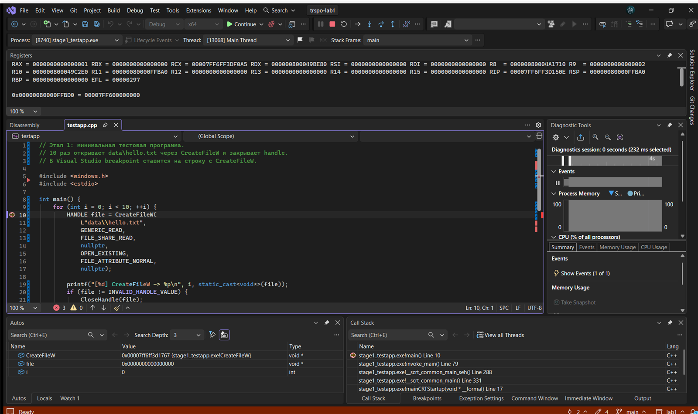
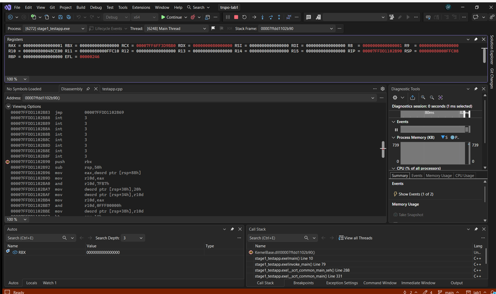

# Этап 1. Тестовая программа, отладка и определение длины патча

## 1. Цель этапа

По заданию лабораторной работы №1 (занятие №1) нужно:

1. написать тестовую программу, которая использует API-функцию
   `kernel32.dll`/`kernelbase.dll`;
2. собрать её под x64;
3. отладить 64-битный процесс и получить трассу вызова выбранной функции;
4. определить, какие изменения нужно внести в ассемблерный код для
   перехвата вызова этой функции.

## 2. Выбранная функция

Основная функция — `CreateFileW`.

Причины:

- она используется в готовой лабораторной в режимах `-func` и `-hide`;
- её легко вызвать из тестовой программы;
- её пролог наглядно показывает, почему нельзя перезаписывать
  фиксированные 11 байт: на текущей Windows 11 граница инструкции
  находится на смещении 13, а не 11.

Дополнительно измерены байты `FindFirstFileW`, `FindNextFileW` и
`CloseHandle` — они понадобятся для `-func` и `-hide` на следующих этапах.

## 3. Что создано

```
stage1/testapp/testapp.cpp        — тестовая программа
stage1/testapp/testapp.vcxproj    — проект Visual Studio (x64 Debug/Release)
stage1/testapp/data/hello.txt     — файл, который открывает CreateFileW
docs/stage1.md                    — этот документ
```

Тестовая программа намеренно минимальная: один файл, без режимов и
аргументов командной строки. Она 10 раз открывает `data\hello.txt`
через `CreateFileW`, печатает handle и закрывает его через `CloseHandle`.
Breakpoint ставится на строку с `CreateFileW`.

`data\hello.txt` лежит рядом с проектом; в Visual Studio рабочая
директория проекта — `stage1\testapp`, поэтому относительный путь
`data\hello.txt` находится. При запуске из консоли нужно перейти в
`stage1\testapp` (см. README).

## 4. Как повторить: Visual Studio

### 4.1. Сборка

1. Открыть `trspo-lab1.sln` в Visual Studio 2026.
2. В панели инструментов выбрать `Debug` и `x64`.
3. Собрать решение: `Ctrl+Shift+B`.
4. Убедиться, что в `Output` есть `stage1_testapp.exe` и ошибок нет.

### 4.2. Подготовка отладчика

1. `Tools → Options → Debugging → General`.
2. Снять галочку **Enable Just My Code**. Без этого Visual Studio
   не будет заходить в системные DLL.
3. `Tools → Options → Debugging → Symbols`: включить
   `Microsoft Symbol Server`, если нужно загрузить символы `kernelbase.dll`.
4. При необходимости: `Debug → Windows → Modules`,
   найти `kernelbase.dll`, правой кнопкой → `Load Symbols`.

### 4.3. Breakpoint и запуск

1. Открыть `stage1/testapp/testapp.cpp`.
2. Найти строку:
   ```cpp
   HANDLE file = CreateFileW(
   ```
3. Поставить breakpoint: щёлкнуть в левом поле или `F9`.
4. Нажать `F5` (Start Debugging).
5. Когда отладчик остановится на строке, нажать `F11` (Step Into).
   Должен открыться код или дизассемблер `kernelbase.dll`.
6. Если Visual Studio перешагнула вызов, использовать
   `Debug → Step Into Specific → CreateFileW`.
   Это делает то же самое, но явно указывает функцию.

### 4.4. Что снять

1. **Call Stack** — `Debug → Windows → Call Stack` (`Ctrl+Alt+C`).
   Полученный стек:
   ```
   KernelBase.dll!00007ffdd1102b90
   stage1_testapp.exe!main      (testapp.cpp, line 10)
   stage1_testapp.exe!invoke_main
   ...
   kernel32.dll!00007ffdd2074107
   ntdll.dll!00007ffdd39a4d50
   ```
   Если символы `kernelbase.dll` загружены, вместо адреса будет
   `KERNELBASE!CreateFileW`. Без символов Visual Studio показывает
   адрес — это нормально, дизассемблер по нему работает.
2. **Disassembly** — `Debug → Windows → Disassembly` (`Ctrl+Alt+D`).
   Записать первые инструкции и их адреса:
   ```
   push rbx
   sub rsp,50h
   mov eax,[rsp+88h]
   ...
   ```
3. **Registers** — `Debug → Windows → Registers` (`Ctrl+Alt+R`).
   Зафиксировать `RCX`, `RDX`, `R8`, `R9`: это первые четыре аргумента
   x64-вызова.
4. **Memory** — `Debug → Windows → Memory → Memory 1`
   (`Ctrl+Alt+M`, затем `1`). В адрес ввести `kernelbase!CreateFileW`
   и посмотреть первые 16 байт.
5. Сделать скриншоты `Disassembly`, `Call Stack`, `Registers` в
   `docs/images/`.
6. Остановить отладку: `Shift+F5`.

### 4.5. Как определить границу инструкции

В окне Disassembly у каждой инструкции есть адрес. Длина инструкции —
разность адресов текущей и следующей инструкции. Нужно накопить длину
до первого значения `N`, которое:

- не меньше 5 байт (столько занимает `E9 rel32`);
- совпадает с границей инструкции;
- не разрывает инструкцию.

Для `CreateFileW` на текущей сборке Windows 11 получено
(проверено 2026-11-04):

| Инструкция | Байты | Смещение после |
|---|---|---:|
| `push rbx` | `40 53` | 2 |
| `sub rsp,50h` | `48 83 EC 50` | 6 |
| `mov eax,[rsp+88h]` | `8B 84 24 88 00 00 00` | 13 |

Следовательно, `N = 13`. Тогда патч:

```
E9 <rel32> 90 90 90 90 90 90 90 90
```

`rel32` считается от адреса следующей инструкции:

```cpp
int32_t rel32 = (int32_t)((uintptr_t)hook - ((uintptr_t)target + 5));
```

### 4.6. Результат отладки

Скриншоты:

- остановка на строке вызова:
  
- дизассемблер `kernelbase.dll` в точке входа `CreateFileW`,
  регистры и стек вызовов:
  

В окне Disassembly видны адреса и инструкции:

```text
00007FFDD1102B90  push        rbx
00007FFDD1102B92  sub         rsp,50h
00007FFDD1102B96  mov         eax,dword ptr [rsp+88h]
00007FFDD1102B9D  mov         r10d,eax
```

В регистрах на входе: `RCX` — путь к файлу, `RDX` — `GENERIC_READ`,
`R8` — `FILE_SHARE_*`, `R9` — атрибуты безопасности. Это подтверждает
x64-соглашение вызова и то, что мы стоим именно на входе в `CreateFileW`.

Сырые данные сохранены в
[stage1-prologue.txt](stage1-prologue.txt).

## 5. Альтернатива: командная строка

Если отладчик Visual Studio недоступен, те же данные можно снять
через WinDbg/cdb:

```text
cdb -o bin\x64\Debug\stage1_testapp.exe
0:000> srv*C:\symbols*https://msdl.microsoft.com/download/symbols
0:000> bp kernelbase!CreateFileW
0:000> g
0:000> k
0:000> u kernelbase!CreateFileW L20
0:000> db kernelbase!CreateFileW L20
0:000> ? kernelbase!CreateFileW - kernelbase
0:000> q
```

Результат сохранить в `docs/stage1-prologue.txt`.

## 6. Таблица измерений

Окружение: Windows 11 Pro 10.0.28000 x64, Visual Studio 2026 18.0.
RVA — смещение от базы `kernelbase.dll`; абсолютные адреса не
сохраняются, потому что ASLR меняет их при каждом запуске.

| Функция | RVA | Первые байты | Границы инструкций | N | Патч |
|---|---|---|---:|---:|---|
| `CreateFileW` | `0x00082B90` | `40 53 48 83 EC 50 8B 84 24 88 00 00 00` | 2, 6, 13 | 13 | `E9 rel32` + 8 NOP |
| `FindFirstFileW` | `0x00078DF0` | `40 53 48 83 EC 30 4C 8B C2 C7 44 24 28` | 2, 6, 9 | 9 | `E9 rel32` + 4 NOP |
| `FindNextFileW` | `0x0007DDE0` | `48 89 5C 24 10 48 89 74 24 18 57 41 54` | 5, 10, 11 | 11 | `E9 rel32` + 6 NOP |
| `CloseHandle` | `0x00083460` | `40 53 48 83 EC 20 48 8B D9 83 F9 F4` | 2, 6, 9, 12, 14 | 6 | `E9 rel32` + 1 NOP |

`CloseHandle` измерен дополнительно: в задании он приведён как пример
API-функции. Для основной лабораторной он не обязателен.

**Вывод:** `SIZE 11` подходит только для `FindNextFileW`. Для
`CreateFileW` нужен `N = 13`, для `FindFirstFileW` — `N = 9`.
Именно поэтому на текущей Windows 11 готовый вариант с `SIZE 11`
падает при `-func CreateFileW` и при `-hide`.

`rel32` зависит от адреса будущей функции-перехватчика в `hook.dll`,
поэтому точное значение вычисляется на этапе 2. Формула:

```cpp
int32_t rel32 = (int32_t)((uintptr_t)hook - ((uintptr_t)target + 5));
```

Проверка: значение должно влезать в signed 32-bit (±2 ГБ). Если не
влезает — нужен абсолютный патч `FF 25 ...` (14 байт) или relay
рядом с целевой функцией.

## 7. Результаты

Выполнено 2026-11-04 на Windows 11 Pro 10.0.28000 x64,
Visual Studio 2026 18.0.

- [x] Проект собирается x64 Debug (без предупреждений и ошибок).
- [x] `stage1_testapp.exe` открывает файл в цикле `CreateFileW`.
- [x] Breakpoint в `CreateFileW` срабатывает; вход в `kernelbase.dll`
      подтверждён стеком вызовов.
- [x] Сняты `Call Stack`, `Disassembly`, `Registers`; скриншоты в
      `docs/images/`.
- [x] Заполнена таблица измерений.
- [x] Формула `rel32` и проверка диапазона ±2 ГБ записаны; фактическое
      значение появится на этапе 2 вместе с адресом `hook`.
- [x] Записано, почему `SIZE 11` не подходит для `CreateFileW` (и для
      `FindFirstFileW`).
- [x] Этап закоммичен в git.

## 8. Изменения в ассемблерный код

По результатам этапа 1 для перехвата `CreateFileW` нужно следующее.

1. В начале функции `CreateFileW` (kernelbase, RVA `0x00082B90`) заменить
   13 байт на:
   ```text
   E9 <rel32> 90 90 90 90 90 90 90 90
   ```
   `rel32` ведёт на будущую функцию-перехватчик в `hook.dll`
   (её адрес появится на этапе 2).

2. Сохранить 13 оригинальных байт и построить трамплин:
   ```text
   13 байт оригинала
   FF 25 00 00 00 00
   <8-байтный адрес target + 13>
   ```
   Размер трамплина — 13 + 14 = 27 байт (выделять с запасом на страницу).

3. Функция-перехватчик на ассемблере должна:
   - сохранить регистры (`rax`, `rbx`, `rcx`, `rdx`, `rsi`, `rdi`, `rbp`,
     `r8`–`r15`);
   - выделить 32 байта shadow space и вызвать функцию логирования
     (`Status`);
   - восстановить регистры;
   - выполнить `jmp` на трамплин.

   В готовой лабораторной это уже сделано в
   [x64_hook_without_detours.asm](<C:/Users/winuser/Desktop/trspo/1/injector/HookDLL_without_detours/x64_hook_without_detours.asm>)
   (функция `x64_hook_without_detours`);
   на этапе 2 этот код переносится в наш проект без изменения логики.
   Для `CreateFileW` аргументов с плавающей точкой нет, поэтому
   сохранять `XMM0–XMM3` не требуется. Если позже понадобится `-func`
   для функции с `float/double`, это надо будет добавить.

4. Для `FindFirstFileW` и `FindNextFileW` использовать свои размеры
   (`N = 9` и `N = 11`), а не общий `SIZE 11`.

## 9. Что дальше

Измеренные значения `N` станут входом для этапа 2:

- класс `HookPatch` получает `size` параметром;
- `Install()` сохраняет `N` байт, ставит `E9 rel32 + NOP`, строит
  трамплин из `N` байт + `FF 25 ...` + адрес `target + N`;
- `Remove()` восстанавливает сохранённые байты и освобождает трамплин;
- в `HookPatch` не должно быть глобального `SIZE 11`; для каждой
  функции используется свой измеренный размер.

На этапе 2 также нужно исправить в готовой лабораторной:
`VirtualAlloc(NULL, size + 8)` → `size + 14`, проверку
`WriteProcessMemory` и откат при ошибке `VirtualAlloc`.
