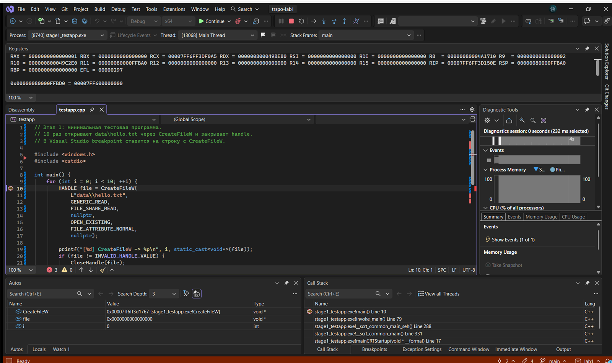
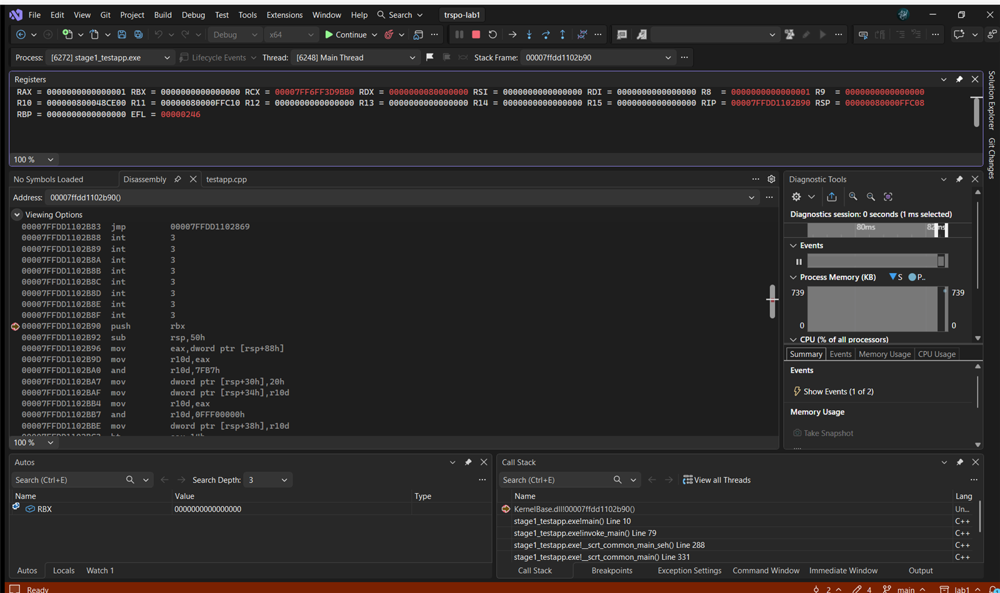

Министерство науки и высшего образования Российской Федерации

Санкт-Петербургский политехнический университет Петра Великого

Институт компьютерных наук и кибербезопасности

Высшая школа кибербезопасности

# ОТЧЁТ ПО ЛАБОРАТОРНОЙ РАБОТЕ № 1

**«Мониторинг событий в процессе»**

по дисциплине «Технологии разработки современного программного обеспечения»

Выполнил: студент гр. 5131001/20502 Дударь Я. А.

Проверил: преподаватель Кубрин Г. С.

Санкт-Петербург, 2026

---

## Содержание

1. [Формулировка задания](#1-формулировка-задания)
2. [Теоретические сведения](#2-теоретические-сведения)
   - [2.1 DLL-инъекция](#21-dll-инъекция)
   - [2.2 Inline-перехват и трамплин](#22-inline-перехват-и-трамплин)
   - [2.3 Соглашение вызова x64](#23-соглашение-вызова-x64)
   - [2.4 Именованный канал](#24-именованный-канал)
3. [Результаты работы](#3-результаты-работы)
   - [3.1 Структура проекта](#31-структура-проекта)
   - [3.2 Прологи функций](#32-прологи-функций)
   - [3.3 Класс HookPatch](#33-класс-hookpatch)
   - [3.4 Загрузка DLL и протокол](#34-загрузка-dll-и-протокол)
   - [3.5 Режим -func](#35-режим--func)
   - [3.6 Режим -hide](#36-режим--hide)
   - [3.7 Интерфейс командной строки](#37-интерфейс-командной-строки)
   - [3.8 Проверка результатов](#38-проверка-результатов)
4. [Выводы](#4-выводы)

---

## 1 Формулировка задания

Целью работы – изучение и практическое освоение техники внедрения собственного кода в целевой процесс для перехвата вызовов функций и изменения его поведения.

В рамках выполнения лабораторной работы необходимо решить следующие задачи:

1. Разработать программу и DLL-библиотеку, обеспечивающие отслеживание вызовов указанных заранее функций. Каждый вызов функции в целевом процессе должен сопровождаться печатью в консоль разрабатываемой программы сообщения, содержащего имя функции и метку времени.
2. Реализовать изменение поведения функций FindFirstFile, FindNextFile и CreateFile так, чтобы для целевого процесса пропадал указанный заранее файл.
3. Обеспечить загрузку DLL-библиотеки в заданный процесс.
4. Реализовать интерфейс командной строки, поддерживающий выбор целевого процесса по PID или по имени, а также режимы `-func` и `-hide`.
5. Не использовать сторонние библиотеки перехвата вызовов (Detours, MinHook, Frida) и поддерживать 64-битные целевые процессы.

Сценарии запуска программы:

```text
monitor.exe -pid 123 -func CreateFile
monitor.exe -name explorer.exe -func CreateFile
monitor.exe -name explorer.exe -hide "C:\hello.txt"
```

Дополнительное задание – реализация аналогичной программы и `.so`-библиотеки под Linux – не выполнялось.

---

## 2 Теоретические сведения

### 2.1 DLL-инъекция

Для выполнения кода в чужом процессе используется загрузка в него собственной динамической библиотеки. Программа открывает целевой процесс функцией `OpenProcess` с правами на создание потока, чтение и запись памяти, выделяет в его адресном пространстве буфер функцией `VirtualAllocEx` и записывает туда путь к DLL функцией `WriteProcessMemory`. Затем `CreateRemoteThread` создаёт поток, точкой входа которого служит `LoadLibraryW`. Библиотека загружается, и её `DllMain` получает управление внутри целевого процесса.

Код завершения потока равен `HMODULE` загруженной библиотеки, поэтому ненулевое значение означает успешную загрузку. Адрес `LoadLibraryW` в `kernel32.dll` одинаков во всех 64-битных процессах, поэтому его можно получить в своей программе и передать удалённому потоку.

### 2.2 Inline-перехват и трамплин

Перехват основан на замене первых байт функции переходом на собственный обработчик. Перезаписывать можно только целые инструкции: если разрезать инструкцию, процесс упадёт. Относительный переход `E9 rel32` занимает 5 байт и достаёт на ±2 ГБ, абсолютный переход `FF 25 00 00 00 00` с 8-байтным адресом – 14 байт.

Чтобы после обработчика можно было выполнить оригинальную функцию, её первые N байт копируются в отдельный блок памяти – трамплин. За скопированными байтами размещается абсолютный переход обратно на адрес `target + N`. Установка хука выполняется в таком порядке: сохранить оригинальные байты, построить трамплин, разрешить запись в страницу с кодом через `VirtualProtect`, записать новые байты, сбросить кэш инструкций `FlushInstructionCache` и восстановить прежнюю защиту страницы.

### 2.3 Соглашение вызова x64

При вызове функции в Windows x64 первые четыре аргумента передаются в регистрах `RCX`, `RDX`, `R8` и `R9`, остальные – через стек. Перед вызовом вызывающий код резервирует 32 байта теневого пространства (shadow space), а стек должен быть выровнен на 16 байт. Ассемблерный обработчик сохраняет регистры общего назначения, вызывает функцию логирования, восстанавливает регистры и переходит в трамплин, поэтому оригинальная функция получает исходные аргументы и состояние стека.

### 2.4 Именованный канал

Управляющая программа и DLL находятся в разных процессах, поэтому обмениваются сообщениями через именованный канал `\\.\pipe\lab1_monitor`. Управляющая программа создаёт серверную часть канала в режиме сообщений, DLL подключается как клиент и переводит свой конец канала в режим `PIPE_READMODE_MESSAGE`. Сообщение – строка с завершающим нулём длиной до 1024 байт.

Сообщение `HELLO` содержит PID процесса и проверяется управляющей программой, чтобы исключить подключение чужой библиотеки. В режиме `-func` канал остаётся открытым, пока жив целевой процесс; в режиме `-hide` после подтверждения `OK hidden` канал закрывается, потому что хуки уже установлены внутри процесса.

---

## 3 Результаты работы

### 3.1 Структура проекта

Проект состоит из трёх частей. `hook.dll` содержит перехватчик и протокол, `monitor.exe` выполняет инъекцию и печатает журнал, `victim.exe` служит тестовой целью. Результаты сборки лежат в `bin\x64\Debug`. Структура каталогов приведена на рисунке 1, назначение файлов – в таблице 1.

> **МЕСТО ДЛЯ РИСУНКА 1**

Рисунок 1 – Структура каталогов проекта

Таблица 1 – Назначение каталогов и файлов проекта

| Элемент | Назначение |
|---|---|
| `src/hook` | `hook.dll`: класс `HookPatch`, `hook_handler.asm`, режимы `-func` и `-hide` |
| `src/monitor` | `monitor.exe`: разбор командной строки, инъекция, клиент канала |
| `src/victim` | `victim.exe`: тестовая цель, перечисление текущего каталога и открытие `secret.txt` |
| `bin/x64/Debug` | готовые `monitor.exe`, `hook.dll`, `victim.exe` |
| `docs` | документация и скриншоты отладки |

### 3.2 Прологи функций

Прологи функций измерены в отладчике Visual Studio на Windows 11 10.0.28000 x64. Абсолютные адреса зависят от ASLR, поэтому в таблице 2 приведены RVA – смещения от базы `kernelbase.dll`.

Таблица 2 – Параметры прологов функций

| Функция | RVA | Границы инструкций | Размер патча |
|---|---|---:|---:|
| `CreateFileW` | `0x00082B90` | 2, 6, 13, 16 | 16 |
| `FindFirstFileW` | `0x00078DF0` | 2, 6, 9 | 9 |
| `FindNextFileW` | `0x0007DDE0` | 5, 10, 11 | 11 |
| `CloseHandle` | `0x00083460` | 2, 6 | 6 |

Первые байты функций:

```text
CreateFileW     40 53 48 83 EC 50 8B 84 24 88 00 00 00 44 8B D0
FindFirstFileW  40 53 48 83 EC 30 4C 8B C2
FindNextFileW   48 89 5C 24 10 48 89 74 24 18 57
CloseHandle     40 53 48 83 EC 20
```

У функции `CreateFileW` первая подходящая граница – 13 байт: `push rbx`, `sub rsp,50h` и `mov eax,[rsp+88h]`. Относительного перехода `E9` достаточно, но абсолютному переходу нужно 14 байт, поэтому следующая целая инструкция `mov r10d,eax` доводит патч до 16 байт. Для остальных функций пролог короче 14 байт, и патч остаётся относительным: `E9 rel32` и `NOP` до границы инструкции. Смещение считается по формуле `rel32 = (int32_t)(hook - (target + 5))` и должно помещаться в знаковые 32 бита.

На рисунке 2 показана остановка на вызове `CreateFileW`, на рисунке 3 – дизассемблер входа функции в `kernelbase.dll`.



Рисунок 2 – Остановка на вызове CreateFileW



Рисунок 3 – Дизассемблер входа CreateFileW в kernelbase.dll

### 3.3 Класс HookPatch

Класс `HookPatch` хранит адрес перехватываемой функции, адрес обработчика и размер патча. Размер передаётся в конструктор, потому что для каждой функции он свой. Метод `Install` собирает новые байты (`E9` или `FF 25`), сохраняет оригинал, строит трамплин и только затем записывает патч. Метод `Remove` возвращает сохранённые байты и освобождает трамплин; деструктор вызывает `Remove`, поэтому забыть снять хук нельзя.

Трамплин состоит из N оригинальных байт и абсолютного перехода обратно:

```text
target:      E9 rel32 90 90 ... 90
trampoline:  <N байт оригинала>
             FF 25 00 00 00 00
             <8-байтный адрес target + N>
```

Установка не приостанавливает другие потоки процесса, поэтому возможна редкая гонка. В тестовой программе она исключена паузой в начале.

### 3.4 Загрузка DLL и протокол

`monitor.exe` берёт `hook.dll` из своего каталога и загружает её в целевой процесс. После возврата из `LoadLibraryW` он создаёт именованный канал; DLL подключается к каналу с повторными попытками и успевает дождаться сервера. Протокол приведён в таблице 3.

Таблица 3 – Сообщения протокола

| Направление | Сообщение | Назначение |
|---|---|---|
| DLL → monitor | `HELLO <PID>` | библиотека загружена и подключилась |
| monitor → DLL | `-func <имя>` | включить мониторинг функции |
| DLL → monitor | `OK hooked` | хук установлен |
| DLL → monitor | `LOG <время> <функция>` | вызов перехваченной функции |
| monitor → DLL | `-hide <путь>` | включить скрытие файла |
| DLL → monitor | `OK hidden` | три хука установлены |
| DLL → monitor | `ERROR <текст>` | ошибка |

Имя канала фиксировано, поэтому одновременно может работать только один экземпляр программы.

### 3.5 Режим -func

В режиме `-func` устанавливается один хук на функцию из таблицы 2. Обработчик `hook_handler` написан на ассемблере: он сохраняет регистры, отводит 32 байта теневого пространства, вызывает функцию `Status`, восстанавливает регистры и переходит в трамплин. `Status` получает местное время и отправляет в канал строку `LOG <время> <функция>`; запись защищена критической секцией.

Если имени функции нет в таблице, DLL отвечает `ERROR unsupported function` и не изменяет код `kernelbase.dll`. Имена `CreateFile`, `FindFirstFile` и `FindNextFile` автоматически приводятся к W-вариантам.

### 3.6 Режим -hide

В режиме `-hide` устанавливаются три хука: `FindNextFileW`, `CreateFileW` и `FindFirstFileW`. Порядок важен: обёртка `FindFirstFileW` использует уже готовый трамплин `FindNextFileW`; при ошибке установки ранее поставленные хуки снимаются.

Обёртка `CreateFileW` проверяет путь и при совпадении возвращает `INVALID_HANDLE_VALUE` с ошибкой `ERROR_FILE_NOT_FOUND`, не вызывая оригинал. Обёртка `FindNextFileW` пропускает записи со скрытым именем и возвращает следующий файл. Обёртка `FindFirstFileW` отвергает прямой путь к скрытому файлу, а если скрытое имя оказалось первым в выдаче по маске, листает каталог оригинальным `FindNextFileW`.

Полный путь и имя сравниваются без учёта регистра, относительный путь разворачивается функцией `GetFullPathNameW`. Формы `\\?\` и короткие имена 8.3 не обрабатываются.

### 3.7 Интерфейс командной строки

Программа поддерживает аргументы, приведённые в таблице 4.

Таблица 4 – Аргументы командной строки

| № | Аргумент | Описание |
|---:|---|---|
| 1 | `-pid <PID>` | целевой процесс выбирается по значению PID |
| 2 | `-name <Имя>` | целевой процесс выбирается по имени |
| 3 | `-func <Имя функции>` | имя функции, вызов которой требуется отследить |
| 4 | `-hide <Имя файла>` | имя файла, который надо скрыть от целевого процесса |

Выбор процесса по PID или по имени взаимоисключающий; режимы `-func` и `-hide` тоже. Для `-hide` монитор делает путь полным и проверяет, что файл существует.

### 3.8 Проверка результатов

Сборка выполнена в Visual Studio 2026 в конфигурации Debug | x64. Файлы `monitor.exe`, `hook.dll` и `victim.exe` находятся в `bin\x64\Debug`. `victim.exe` запускается с рабочим каталогом `src\victim\data`, `monitor.exe` — из корня проекта:

```text
bin\x64\Debug\monitor.exe -pid <PID> -func CreateFileW
bin\x64\Debug\monitor.exe -pid <PID> -hide C:\...\src\victim\data\secret.txt
```

В режиме `-func` за 20 вызовов функции управляющая программа печатает 20 строк `LOG`, а `victim.exe` на каждой итерации показывает `entries=5`, `secret=yes` и `open=ok`: в каталоге видны `.`, `..`, `aaa.txt`, `secret.txt` и `zzz.txt`. Журнал приведён на рисунке 4.

> **МЕСТО ДЛЯ РИСУНКА 4**

Рисунок 4 – Режим -func: журнал вызовов CreateFileW

В режиме `-hide` в перечислении остаются `.`, `..`, `aaa.txt` и `zzz.txt`, строка `secret.txt` исчезает, число записей уменьшается до 4, `secret=no`, а `CreateFileW` возвращает ошибку 2 (`ERROR_FILE_NOT_FOUND`). Результат показан на рисунке 5.

> **МЕСТО ДЛЯ РИСУНКА 5**

Рисунок 5 – Режим -hide: файл пропадает из каталога и не открывается

Команда `-func MessageBoxW` возвращает `ERROR unsupported function` и код завершения 1; целевой процесс при этом остаётся запущенным. Результаты сведены в таблицу 5.

Таблица 5 – Результаты прогона

| Режим | Команда | Результат |
|---|---|---|
| `-func` | `-pid <PID> -func CreateFileW` | 20 строк `LOG`; `victim`: `entries=5`, `secret=yes`, `open=ok` |
| `-hide` | `-pid <PID> -hide <путь>` | `entries=4`, `secret=no`, `open=fail err=2` |
| `-func` | `-pid <PID> -func MessageBoxW` | `ERROR unsupported function`, код 1 |

---

## 4 Выводы

В ходе работы изучена техника DLL-инъекции и inline-перехвата функций WinAPI. Разработаны `hook.dll` и `monitor.exe`: библиотека загружается в целевой процесс удалённым потоком, подключается к именованному каналу и по команде устанавливает хуки; управляющая программа разбирает командную строку, выполняет инъекцию и печатает журнал вызовов.

Перехват реализован самостоятельно, без Detours, MinHook и Frida. Класс `HookPatch` заменяет целое число инструкций пролога, строит трамплин и корректно снимает хук; длина патча для каждой функции измерена в отладчике. Режим `-func` печатает имя функции и время на каждый вызов, режим `-hide` скрывает файл из перечисления и запрещает его открытие, не затрагивая соседние файлы.

Ограничения работы: поддерживаются только измеренные функции, относительный патч требует близкого расположения DLL к `kernelbase.dll`, скрытие не покрывает `\\?\`-пути, короткие имена 8.3 и обращения через A-варианты функций, а установка хука не приостанавливает потоки процесса. Эти ограничения не мешают демонстрации, но важны при использовании подхода в реальных задачах.
